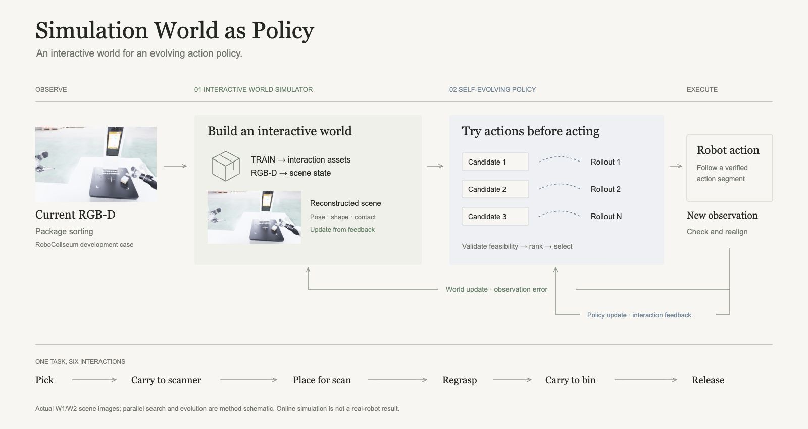
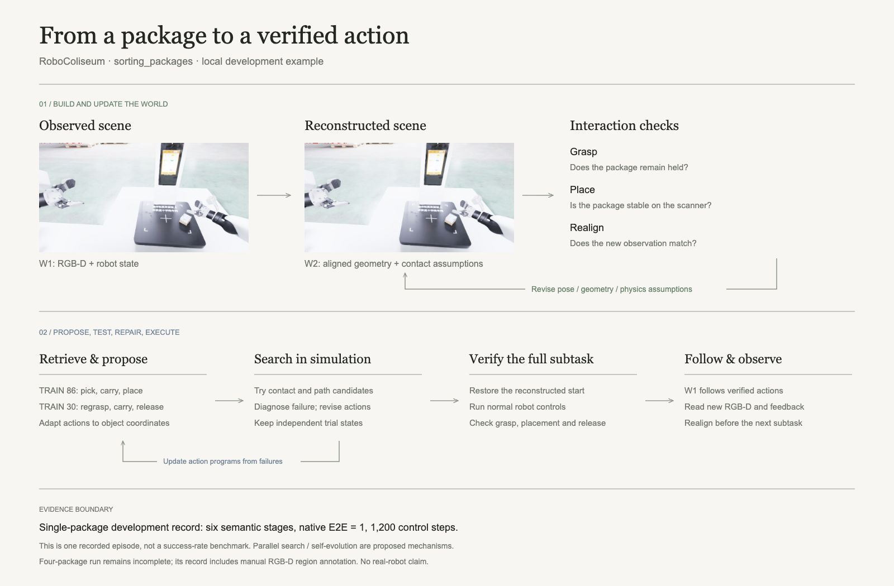

# Simulation World as Policy

Using an interactive simulator to generate, test, and improve robot actions.

[中文](docs/zh/README.md) · [Website source](web/) · [Architecture](docs/architecture.md) · [Evaluation](docs/evaluation.md)

This research explores how a GPT agent can build a scene from TRAIN references and online RGB-D, test candidate actions in simulation, and execute them with observation-based feedback. The repository contains the website, method figures, and design documents; controller integration is planned.

## Experiment videos

- [RGB-D observations](web/media/videos/rgbd-observations.mp4) — TRAIN episode 301 · three camera views with rendered depth from an RGB-aligned scene.
- [Grasp outcomes across worlds](web/media/videos/grasp-comparison.mp4) — Recorded physics trials: source-scene and reconstructed-asset success and failure pairs.
- [A placement candidate](web/media/videos/candidate-placement.mp4) — W2 simulation · a candidate that places the second block off target.
- [Three-block tower execution](web/media/videos/tower-execution.mp4) — W1 simulation · the complete recorded tower-building episode, at 12× speed.

## Method



**Interactive World Simulator.** Build interaction assets and reconstruct the current scene. Use observed contact and motion to refine geometry, pose, and physical parameters.

**Self-Evolving Policy.** Explore candidate actions in independent simulation branches. Repair failures, validate complete subtasks, and use execution feedback to improve action programs and skills.

## Example: package sorting

In RoboColiseum’s `sorting_packages` task, the robot picks up a package, places it on a scanner, grasps it again, and releases it into a bin. TRAIN 86 supplies the first three action references; TRAIN 30 supplies the remaining three.



One recorded single-package development episode completed all six stages in 1,200 control steps, with native E2E = 1. The figures combine its W1/W2 scene images with the proposed search architecture. [Source records and editable figures](assets/figures-v2/README.md).

## View the website

Open `web/index.html` in a browser, or run this command from the repository root:

```sh
python3 -m http.server 18765 --bind 127.0.0.1
```

Visit [English](http://127.0.0.1:18765/web/) or [中文](http://127.0.0.1:18765/web/zh/). The website can be previewed locally.
