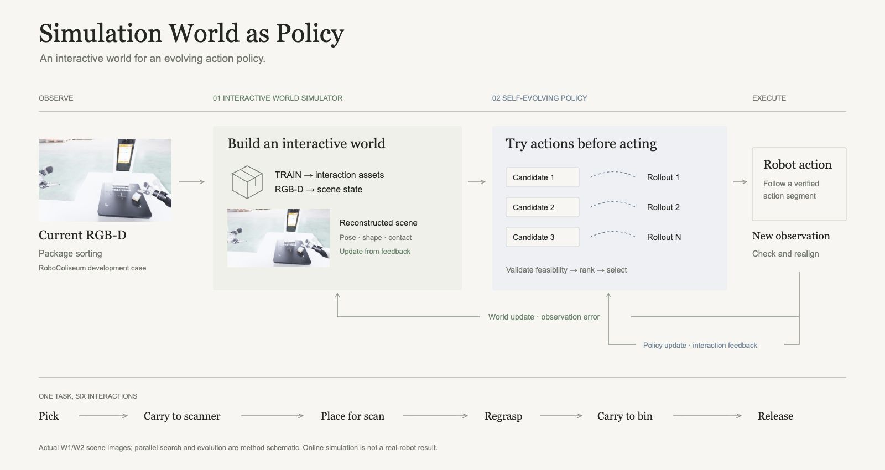
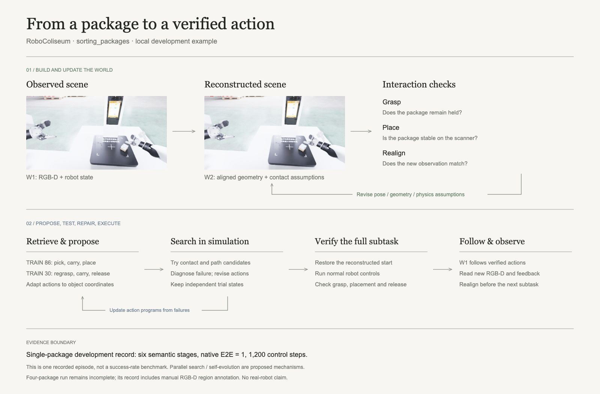

# Simulation World as Policy

用可交互的仿真世界生成、检验和改进机器人动作。

[English](../../README.md) · [网页源码](../../web/) · [系统架构](../architecture.md) · [评价协议](../evaluation.md)

本研究探索如何让 GPT Agent 根据 TRAIN 参考和在线 RGB-D 构建场景，在仿真中测试候选动作，并通过观测反馈完成闭环执行。仓库包含网页、方法图和设计文档，控制器集成为后续工作。

## 方法



**Interactive World Simulator。** 构建交互资产与当前场景，根据观测到的接触和运动修正几何、位姿与物理参数。

**Self-Evolving Policy。** 在独立仿真分支中探索候选动作，修复失败，完整验证子任务，再利用执行反馈改进动作程序与技能。

## 示例：包裹分拣

RoboColiseum 的 `sorting_packages` 任务要求机器人抓起包裹、放到扫描台、再次抓取，最后松手入筐。前三段动作参考来自 TRAIN 86，后三段来自 TRAIN 30。



一次已记录的单包开发回合在 1,200 控制步内完成全部六个阶段，原生 E2E = 1。图中将该回合的 W1/W2 场景画面与拟议的搜索架构结合展示。[源记录与可编辑图](../../assets/figures-v2/README.md)。

## 查看网页

用浏览器打开 `web/index.html`，或在仓库根目录运行：

```sh
python3 -m http.server 18765 --bind 127.0.0.1
```

访问[英文版](http://127.0.0.1:18765/web/)或[中文版](http://127.0.0.1:18765/web/zh/)。网页可在本地预览。
